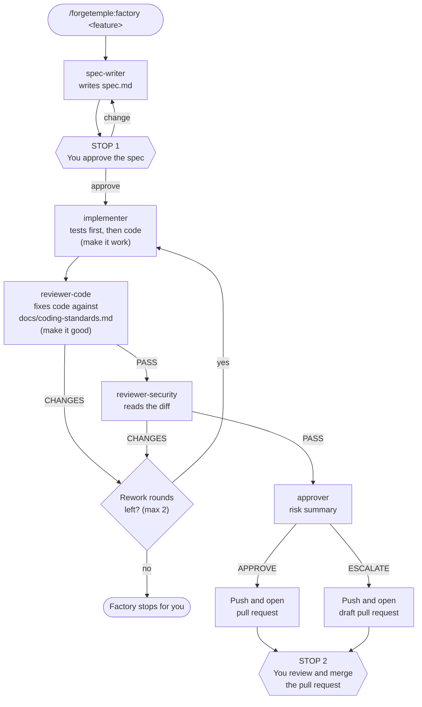

# forgeTemple

A small software factory for Claude Code. You give it a feature. It writes a spec, builds the feature with tests first, reviews it, and opens a pull request.

It is a Claude Code plugin for TypeScript projects. You install it in a project, and you keep the project rules in your own repository.

## How one job runs



| Part | Default model | Changes code |
| --- | --- | --- |
| Orchestrator (your session) | Opus | No |
| `spec-writer` | Sonnet | No |
| `implementer` | Sonnet | Yes |
| `reviewer-code` | Sonnet | Yes, behaviour stays the same |
| `reviewer-security` | Sonnet | No |
| `approver` | Sonnet | No |

## Install in a project

forgeTemple is a Claude Code plugin. This repository is also its marketplace.

Run these from the root of your project:

```bash
# Add the marketplace (one time per machine)
claude plugin marketplace add lechip/forgeTemple

# Install the plugin. --scope project enables it in .claude/settings.json,
# which you commit. Each teammate still installs it on their own machine.
claude plugin install forgetemple@forgetemple --scope project \
  --config implementer_model=opus
```

Each `--config` is optional. Inside Claude Code, `/plugin install forgetemple@forgetemple` asks for the same settings in a dialog.

Then start Claude Code in your project and run:

```
/forgetemple:init
```

`init` sets up the project files:

| File | What `init` does |
| --- | --- |
| `factory/dashboard.html` | Copies it. Refreshes it on each run. |
| `factory/jobs/.gitkeep` | Creates it. |
| `docs/coding-standards.md` | Copies the template only if the file does not exist. |
| `.gitignore` | Adds the `factory/jobs` lines if they are missing. |
| `CLAUDE.md` | If there is no "Commands" section, drafts one from `package.json` and asks you before it writes. |

Then edit `docs/coding-standards.md` for your project.

### Update

```bash
claude plugin marketplace update forgetemple
claude plugin update forgetemple@forgetemple
```

Then run `/forgetemple:init` again. It refreshes the dashboard and keeps your own files.

### The Commands section

The factory reads the project commands from `CLAUDE.md`. `init` drafts this section. You can also write it yourself:

```markdown
## Commands

- setup: `npm install`
- test: `npm test`
- test integration: `npm run test:integration`
- test e2e: `npm run test:e2e`
- lint: `npm run lint`
- typecheck: `npm run typecheck`
- build: `npm run build`
```

`setup`, `test`, `lint`, and `typecheck` are necessary. The others are optional.

## Models

Each agent runs on the model you choose. Valid values: `default`, `sonnet`, `opus`, `haiku`, `fable`. `default` uses the `model:` line of the agent file, which is `sonnet`.

The factory picks the model of each agent in this order:

1. A "Factory models" section in the project `CLAUDE.md`. It is committed, so it holds for everyone in the project:

   ```markdown
   ## Factory models

   - implementer: opus
   - reviewer-code: opus
   ```

2. The plugin settings. They are yours, for all projects on your machine. Set them at install with `--config <setting>=<model>`, and change them later with `/config` or `/plugin configure forgetemple@forgetemple`.

| Agent | Setting |
| --- | --- |
| `spec-writer` | `spec_writer_model` |
| `implementer` | `implementer_model` |
| `reviewer-code` | `reviewer_code_model` |
| `reviewer-security` | `reviewer_security_model` |
| `approver` | `approver_model` |

The orchestrator runs on Opus. That is the `model:` line of `plugins/forgetemple/skills/factory/SKILL.md`, and you can only change it in the plugin itself.

Each job records its models in `job.json`, and the dashboard shows them. A change applies to the next job.

## Use

Start Claude Code in your project. Use an Opus model for the session.

| Command | What it does |
| --- | --- |
| `/forgetemple:init` | Sets up or refreshes the factory files in the project. |
| `/forgetemple:factory <feature>` | Starts a job in a git worktree (a second copy of the repository in a different folder). |
| `/forgetemple:factory <path to spec or issue file>` | Starts a job from an existing file. |
| `/forgetemple:factory --branch <feature>` | Starts a job on a branch in the same folder. |
| `/forgetemple:factory rework <job-id> <note>` | Changes a job after the pull request is open. |
| `/forgetemple:factory clean <job-id>` | Removes the worktree and the local branch after the merge. |

- Worktree mode puts the work in `../<repo-name>-factory/<job-id>`. Your main folder stays clean. You can run one job per Claude Code session at the same time.
- Branch mode needs a clean checkout. Run one job at a time.
- The branch name is `factory/<job-id>`.
- With no GitHub remote or no `gh` tool, the factory keeps the branch on your disk and stops.

## Dashboard

```bash
python3 -m http.server 5175 --directory factory
```

Open <http://localhost:5175/dashboard.html>. It refreshes every 2 seconds.

## Job files

Each job has a folder `factory/jobs/<job-id>/`. Git ignores it.

| File | Writer | Content |
| --- | --- | --- |
| `job.json` | orchestrator | State of the job. The dashboard reads it. |
| `spec.md` | `spec-writer` | Acceptance criteria and tasks. |
| `build.md` | `implementer` | What was built and the check results. |
| `round-N/review-code.md` | `reviewer-code` | What it fixed. `VERDICT: PASS` or `CHANGES`. |
| `round-N/review-security.md` | `reviewer-security` | Findings. `VERDICT: PASS` or `CHANGES`. |
| `decision.md` | `approver` | Risk summary. `APPROVE` or `ESCALATE`. Becomes the pull request text. |
| `rework-K.md` | orchestrator | Your rework note. |

## Change the factory

In your project:

- Code rules and test rules: edit `docs/coding-standards.md`.
- Commands and models: edit the "Commands" and "Factory models" sections of `CLAUDE.md`.

In the plugin (fork this repository, and add your fork as the marketplace):

- What one agent does: edit its file in `plugins/forgetemple/agents/`.
- The order of steps, the stops, the rework limit: edit `plugins/forgetemple/skills/factory/SKILL.md`.
- A new reviewer (for example UX or UI): copy `reviewer-security.md`, change the checks, and add a step in `SKILL.md`. Add its verdict to `job.json` and to `templates/dashboard.html`. Add a model setting for it to `.claude-plugin/plugin.json`.
- Automatic merge: change step 8 and step 9 in `SKILL.md`.

To try a change without installing, start Claude Code with `claude --plugin-dir <path to>/plugins/forgetemple`. If a plugin setting has no value there, the agent uses `default`, unless the project has a "Factory models" section.

Check the plugin with `claude plugin validate .` from the repository root.

## Sources

The design takes ideas from three places:

- The ZazenCodes software factory: the `/factory` skill, the agent roles, the job files, the dashboard.
- The cadence plugin: the test quality rules and the typed verdict line.
- Matt Pocock, "Fixing the PR Bottleneck": the two-stage pattern, the repository-level standards file, the reviewer that commits fixes, the risk summary on the pull request.
