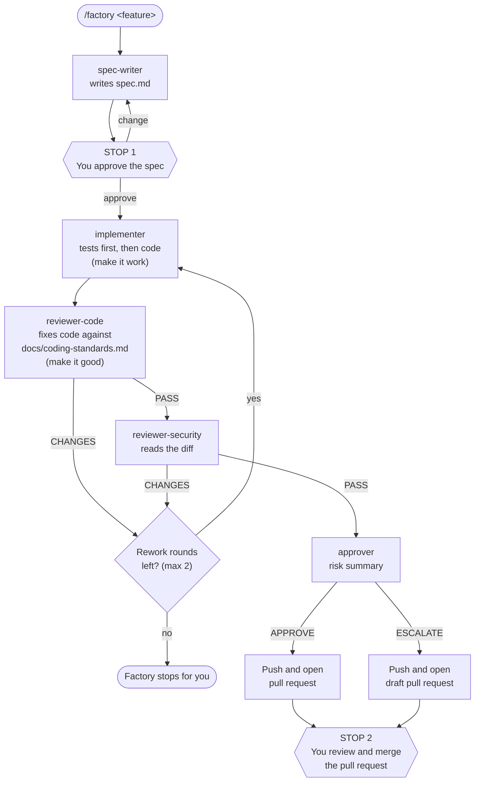

# forgeTemple

A small software factory for Claude Code. You give it a feature. It writes a spec, builds the feature with tests first, reviews it, and opens a pull request.

It is a template for TypeScript projects. Copy it into your project and edit it.

## How one job runs



| Part | Model | Changes code |
| --- | --- | --- |
| Orchestrator (your session) | Opus | No |
| `spec-writer` | Sonnet | No |
| `implementer` | Sonnet | Yes |
| `reviewer-code` | Sonnet | Yes, behaviour stays the same |
| `reviewer-security` | Sonnet | No |
| `approver` | Sonnet | No |

## Install in a project

Run these from the root of your project:

```bash
FACTORY=/Users/oscarbarrios/Projects/forgeTemple

mkdir -p .claude/skills .claude/agents docs factory/jobs
cp -R "$FACTORY/.claude/skills/factory" .claude/skills/
cp "$FACTORY"/.claude/agents/*.md .claude/agents/
cp "$FACTORY/factory/dashboard.html" factory/
touch factory/jobs/.gitkeep
cp -n "$FACTORY/docs/coding-standards.md" docs/
printf '\nfactory/jobs/*\n!factory/jobs/.gitkeep\n' >> .gitignore
```

Then do these two steps:

1. Add a "Commands" section to the `CLAUDE.md` of your project (see below).
2. Edit `docs/coding-standards.md` for your project.

### The Commands section

The factory reads the project commands from `CLAUDE.md`. Add this section and change the commands:

```markdown
## Commands

- setup: `yarn install`
- test: `yarn test`
- test integration: `yarn test:integration`
- test e2e: `yarn test:e2e`
- lint: `yarn lint`
- typecheck: `yarn typecheck`
- build: `yarn build`
```

`setup`, `test`, `lint`, and `typecheck` are necessary. The others are optional.

## Use

Start Claude Code in your project. Use an Opus model for the session.

| Command | What it does |
| --- | --- |
| `/factory <feature>` | Starts a job in a git worktree (a second copy of the repository in a different folder). |
| `/factory <path to spec or issue file>` | Starts a job from an existing file. |
| `/factory --branch <feature>` | Starts a job on a branch in the same folder. |
| `/factory rework <job-id> <note>` | Changes a job after the pull request is open. |
| `/factory clean <job-id>` | Removes the worktree and the local branch after the merge. |

- Worktree mode puts the work in `../<repo-name>-factory/<job-id>`. Your main folder stays clean. You can run one job per Claude Code session at the same time.
- Branch mode needs a clean checkout. Run one job at a time.
- The branch name is `factory/<job-id>`.
- With no GitHub remote or no `gh` tool, the factory keeps the branch on your disk and stops.

## Dashboard

```bash
python3 -m http.server 5175 --directory factory
```

Open <http://localhost:5175/dashboard.html>. It refreshes every 2 seconds.

## Job files

Each job has a folder `factory/jobs/<job-id>/`. Git ignores it.

| File | Writer | Content |
| --- | --- | --- |
| `job.json` | orchestrator | State of the job. The dashboard reads it. |
| `spec.md` | `spec-writer` | Acceptance criteria and tasks. |
| `build.md` | `implementer` | What was built and the check results. |
| `round-N/review-code.md` | `reviewer-code` | What it fixed. `VERDICT: PASS` or `CHANGES`. |
| `round-N/review-security.md` | `reviewer-security` | Findings. `VERDICT: PASS` or `CHANGES`. |
| `decision.md` | `approver` | Risk summary. `APPROVE` or `ESCALATE`. Becomes the pull request text. |
| `rework-K.md` | orchestrator | Your rework note. |

## Change the factory

- Code rules and test rules: edit `docs/coding-standards.md`.
- What one agent does: edit its file in `.claude/agents/`.
- The order of steps, the stops, the rework limit: edit `.claude/skills/factory/SKILL.md`.
- A new reviewer (for example UX or UI): copy `reviewer-security.md`, change the checks, and add a step in `SKILL.md`. Add its verdict to `job.json` and to `factory/dashboard.html`.
- Automatic merge: change step 8 and step 9 in `SKILL.md`.

## Sources

The design takes ideas from three places:

- The ZazenCodes software factory: the `/factory` skill, the agent roles, the job files, the dashboard.
- The cadence plugin: the test quality rules and the typed verdict line.
- Matt Pocock, "Fixing the PR Bottleneck": the two-stage pattern, the repository-level standards file, the reviewer that commits fixes, the risk summary on the pull request.
